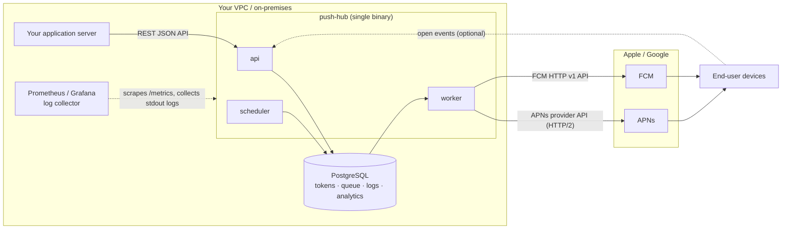

# push-hub

A self-hosted push notification delivery engine for enterprises. Deploy it inside your own VPC or on-premises, and send APNs / FCM notifications without handing your data to a SaaS provider.

> **Status: Work in progress — demand validation.**
> push-hub is in the demand validation phase. There is no production code yet, and the scope described here may change. push-hub is **source-available** under the [Business Source License 1.1](LICENSE), not Open Source.

## The Problem

Push notification SaaS is easy to start with, but becomes hard to justify as you grow:

1. **Data sovereignty and compliance:** customer behavior logs, notification bodies, and device tokens are stored on an external provider's servers, often in another country.
2. **The "SaaS Tax":** pay-per-use pricing grows with delivery volume, and becomes a major cost at millions to hundreds of millions of notifications per month.
3. **Vendor lock-in:** your delivery pipeline, device data, and analytics depend on a single provider.

## Who Is This For

* **B2B enterprises and security-focused startups** in healthcare, finance, SaaS, government, and similar sectors that cannot send customer data or push tokens to external SaaS providers.
* **Development and DevOps teams** that deliver millions to hundreds of millions of push notifications per month and want predictable costs.

## Data Governance by Design

push-hub runs entirely inside your infrastructure:

* **Your data stays in your database.** Device tokens, recipient attributes, notification content, delivery logs, and analytics are stored in your own PostgreSQL.
* **The only outbound traffic goes to APNs and FCM.** push-hub sends no telemetry, usage statistics, or crash reports anywhere.
* **No license server.** push-hub never phones home to check a license, so it also works in air-gapped environments.
* **Runs on any cloud or on-premises.** The only required dependency is PostgreSQL, which is available as a managed service on AWS, GCP, and Azure. No cloud-specific services are used.
* **Standard observability.** Metrics, logs, and health checks plug into the tools you already run (Prometheus, Grafana, Datadog, CloudWatch, ELK).

> **What push-hub cannot change:** to deliver a notification, its content and the device token must be sent to Apple (APNs) or Google (FCM). This is true for every push provider, including SaaS. push-hub removes the additional third party in between, but it does not remove Apple or Google from the path. Keep sensitive data out of notification bodies where possible.

## Architecture

* **Delivery flow:** your application server calls the REST API, `api` enqueues a job in PostgreSQL, and `worker` picks it up and sends it to APNs / FCM. For scheduled deliveries, `scheduler` enqueues the job when it is due.
* **Storage:** device tokens, recipient attributes, notification content, delivery logs, and analytics all stay in your own PostgreSQL.
* **The only traffic leaving your network is `worker` → APNs / FCM.** There is no telemetry and no license check.
* **Open tracking (optional):** APNs and FCM do not report opens, so your app reports them to `api` through `POST /v1/events`.
* **Monitoring:** your own Prometheus and log collector pull metrics and logs from push-hub.

See [docs/ARCHITECTURE.md](docs/ARCHITECTURE.md) for the architecture direction.

## Quick Start

<!-- TODO(#10): docker-compose.yml startup example -->

## API

<!-- TODO(#10): API response specification mock -->

## Observability

> **Planned — not implemented yet.**

* **Metrics:** Prometheus-format endpoint at `/metrics`.
* **Logs:** structured JSON logs written to stdout, ready for Datadog, CloudWatch, ELK, and other log collectors.
* **Health checks:** `/healthz` (liveness) and `/readyz` (readiness) for Kubernetes probes and load balancers.
* **Grafana dashboard:** a sample dashboard definition (JSON) will be included.
* **Separate admin port:** `/metrics`, `/healthz`, and `/readyz` are served on an admin port separate from the API port, so they are not exposed with the public API.

See [docs/ARCHITECTURE.md](docs/ARCHITECTURE.md#25-observability) for the design direction.

## Support the Project

<!-- TODO(#12): Star request and link to the demand validation form -->

## License

push-hub is **source-available** software licensed under the [Business Source License 1.1](LICENSE) (BSL 1.1).

| Your use | License required |
|----------|------------------|
| Non-production use (development, testing, evaluation, PoC) | Free |
| Production use by a Small Business (fewer than 100 employees and contractors, and less than US$1M in annual revenue, including affiliates) | Free |
| Non-Commercial Use | Free |
| Any other production use | Commercial license |
| Offering push-hub to third parties as a hosted or managed service | Not permitted under the BSL; requires a separate agreement |

Each tagged release automatically converts to the [Apache License 2.0](https://www.apache.org/licenses/LICENSE-2.0) three years after its release date.

See [LICENSE](LICENSE) for the exact terms. For commercial licensing, please contact **aianchor.lab@gmail.com**.

## Contributing

Contributions require agreement to the [Contributor License Agreement](CLA.md). See [CONTRIBUTING.md](CONTRIBUTING.md) for details.

> **Note:** we are not accepting external pull requests until a legally reviewed version of the CLA has been published.

## Security

Please do not report security vulnerabilities through public issues. See [SECURITY.md](SECURITY.md).
